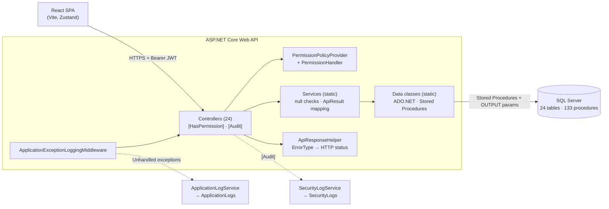

# MyHospital — Hospital Operations API

A full-stack hospital management system built with **ASP.NET Core Web API, SQL Server, and ADO.NET**, featuring database-enforced appointment scheduling and billing rules, JWT authentication, transactional refresh-token rotation, and bitmask-based authorization.

---

## 📌 Table of Contents

* [Overview](#-overview)
* [Project Demo](#-project-demo)
* [Why This Project](#-why-this-project)
* [Architecture](#️-architecture)
* [Domain Model](#-domain-model)
* [Database Design](#️-database-design)
* [Authentication & Authorization](#-authentication--authorization)
* [Security Considerations](#-security-considerations)
* [Business Rules](#️-business-rules)
* [Concurrency & Consistency](#-concurrency--consistency)
* [API](#-api)
* [Backend Implementation](#-backend-implementation)
* [Key Workflows](#-key-workflows)
* [Error Handling & Auditing](#️-error-handling--auditing)
* [Frontend](#️-frontend)
* [Code Generation & AI-Assisted Development](#-code-generation--ai-assisted-development)
* [Project Metrics](#-project-metrics)
* [Engineering Highlights](#-engineering-highlights)
* [Key Design Decisions](#-key-design-decisions)
* [Tech Stack](#-tech-stack)
* [Running Locally](#-running-locally)
* [Repository Structure](#-repository-structure)
* [Future Improvements](#-future-improvements)
* [Contact](#-contact)

---

## 🎯 Overview

MyHospital models the day-to-day operations of a hospital: people and their roles, doctor schedules, rooms, appointments, insurance subscriptions, invoices and payments, medical history, and staff access control.

The backend is an **ASP.NET Core Web API** that communicates with **SQL Server exclusively through stored procedures using ADO.NET**, with no ORM.

Business rules such as appointment overlap prevention, role exclusivity, insurance calculations, and payment limits are enforced at the database layer so they remain consistent regardless of which client calls the API.

A React single-page application consumes the API and mirrors the backend authorization model for permission-aware UI behavior.

### Key Highlights

* **24 database tables**
* **133 stored procedures**
* **127 API endpoints**
* **24 controllers**
* **24 services**
* **24 data-access classes**
* **26 foreign keys**
* **24 CHECK constraints**
* **78 seeded permissions across two bigint masks**
* **108 permission-protected endpoints**
* **66 audited endpoints**
* **Transactional refresh-token rotation**
* **BCrypt-hashed refresh-token secrets**
* **Database-enforced appointment overlap protection**
* **Insurance-aware invoicing with capped partial payments**
* **Async ADO.NET with `CancellationToken`**
* **Generic entity-driven React data layer**
* **Code generation for repetitive backend and frontend structures**
* **Permission-aware React UI**

---

## 🎥 Project Demo

A video walkthrough of the project is available on LinkedIn:

**[▶️ Watch the MyHospital project walkthrough on LinkedIn](http://linkedin.com/posts/baraa-mardini-a42698356_dotnet-aspnetcore-csharp-ugcPost-7508561912243183616-eqTH)**

The walkthrough demonstrates parts of the system, including the application UI, user creation, and permission assignment.

---

## 💡 Why This Project

MyHospital was designed around the idea that critical hospital business rules should not depend solely on client-side validation.

The system therefore places important invariants close to the data through:

* SQL constraints
* Unique indexes
* Stored procedures
* Database transactions
* Permission masks
* Explicit error types

The project focuses on:

* Database-enforced business rules
* Secure authentication and refresh-token rotation
* Fine-grained permission-based authorization
* Transactional billing and scheduling workflows
* Explicit ADO.NET data access without an ORM
* Auditable API operations
* Centralized error and response handling
* Reusable frontend architecture
* Reducing repetitive implementation through code generation

The goal is not simply to expose CRUD endpoints, but to keep important business rules consistent regardless of which client interacts with the API.

---

## 🏗️ Architecture



### Request Flow

```text
React SPA
   ↓
Controller
   ↓
Authorization
   ↓
Service
   ↓
Data Access
   ↓
Stored Procedure
   ↓
SQL Server
```

* **Controllers** declare required permissions with `[HasPermission(mask1, mask2)]` and opt into audit logging with `[Audit("…")]`.
* **Services** and **Data** classes are static; logging services and authorization components are wired through dependency injection.
* Every stored procedure reports its outcome through `@Message` and `@ErrorType` output parameters.
* The data layer maps database error codes to a typed `ErrorType` enum.
* `ApiResponseHelper` converts the result into the appropriate HTTP response.

---

## 🧩 Key Design Decisions

### ADO.NET Instead of an ORM

The backend communicates with SQL Server through ADO.NET and stored procedures rather than an ORM.

This provides explicit control over:

* SQL commands
* Stored procedures
* Parameters
* SQL data types
* Transactions
* Database-generated results

### Stored Procedures for Business Rules

Critical business rules are enforced in SQL Server so they cannot be bypassed by another API path or client.

Examples include:

* Appointment overlap prevention
* Payment limits
* Insurance calculations
* Role exclusivity
* Delete dependency checks
* Permission mask calculation

### Database-Enforced Validation

SQL Server constraints and stored procedures are used together.

Constraints enforce structural rules such as:

* Valid age range
* Valid blood types
* Non-negative monetary values
* Insurance coverage range
* Valid insurance dates
* Positive payments
* Valid permission bit indexes

Stored procedures handle more complex business rules.

### Bitmask-Based Authorization

Permissions are represented across two `bigint` masks.

The masks are stored on the user and included in JWT claims, allowing the authorization system to evaluate multiple permissions through bitwise operations.

### Transactional Refresh-Token Rotation

Refresh-token rotation is handled by `SP_RotateRefreshToken`.

The old token is revoked and the new token is inserted inside the same database transaction. If the old token has already been revoked, the operation fails and the transaction rolls back.

### Generic Frontend Architecture

The React application uses configuration-driven entity definitions together with reusable API and Zustand store factories.

This avoids implementing the same CRUD infrastructure independently for every entity.

---

## 🧬 Domain Model

The model is centered around a single `People` table.

A person can be a **Patient**, **Doctor**, or **Employee**, while database rules prevent the same person from holding more than one of these roles.

| Area       | Entities                                                                           |
| ---------- | ---------------------------------------------------------------------------------- |
| Identity   | `People` → `Patient`, `Doctor`, `Employee`                                         |
| Clinical   | `Specialization`, `Department`, `Work_Day`, `Work_Schedule`, `MedicalHistory`      |
| Facilities | `RoomType`, `Room`                                                                 |
| Scheduling | `Appointment`                                                                      |
| Billing    | `Insurance`, `InsuranceSubscriptions`, `Invoices`, `InvoicePayments`               |
| Lookup     | `StatusType`, `Status`                                                             |
| Security   | `Role`, `Permissions`, `Users`, `RefreshTokens`, `SecurityLogs`, `ApplicationLogs` |

### Status Model

Statuses are stored as data rather than hard-coded enums.

`StatusType` groups status records for different modules such as:

* Employee
* Appointment
* Invoice

Seeded appointment statuses include:

`Scheduled`, `Confirmed`, `Completed`, `Cancelled`, `No Show`

Invoice statuses include:

`Pending`, `Partially Paid`, `Paid`, `Cancelled`, `Refunded`

---

## 🗄️ Database Design

| Item                                |                                        Count |
| ----------------------------------- | -------------------------------------------: |
| Tables                              |                                       **24** |
| Stored procedures                   |                                      **133** |
| Foreign keys                        |                                       **26** |
| CHECK constraints                   |                                       **24** |
| UNIQUE constraints / unique indexes | **15 constraints + 1 filtered unique index** |
| User-defined table types            |                **1** (`PermissionTableType`) |
| Views / functions / triggers        |                                        **0** |

### Constraint-First Validation

Important data rules are enforced directly by SQL Server:

* Age between `0–120`
* Email and phone format validation
* Blood type whitelist
* Non-negative monetary values
* Insurance coverage between `0–100`
* `EndDate > StartDate` for insurance subscriptions
* `AmountPaid > 0`
* Permission `BitIndex` between `0` and `63`

### Filtered Unique Index

`People.Email` uses a filtered unique index:

```sql
WHERE Email IS NOT NULL
```

This allows multiple people without an email address while preventing duplicate non-null email addresses.

### Stored Procedure Convention

Entity CRUD operations follow a consistent naming convention:

```text
SP_Add*
SP_Get*ByID
SP_GetAll*
SP_Update*ByID
SP_Delete*ByID
SP_Search*
```

Procedures use `TRY/CATCH` handling and communicate their result through:

```text
@NewID
@Message
@ErrorType
```

### Delete Guards

Delete procedures check logical dependencies before deleting records.

For example:

* A room with existing appointments cannot be deleted.
* A patient with appointments or medical history cannot be deleted.
* A role assigned to employees or users cannot be deleted.

Instead of exposing a raw SQL foreign-key violation, the API receives a meaningful `LogicalDependency` error.

### Seed Data

The database includes synthetic demo data:

* 70 people
* 220 appointments
* 175 invoices
* 137 payments
* 78 permissions
* 7 roles

---

## 🔐 Authentication & Authorization

### Authentication

Login is handled through:

```http
POST /api/LoginRequest/Login
```

The flow is:

```text
Username + Password
        ↓
SP_LoginRequest
        ↓
BCrypt password verification
        ↓
JWT + Refresh Token
```

The login procedure rejects unknown and deactivated accounts.

Authentication failures return:

```text
401 Invalid username or password.
```

### JWT

The access token uses **HMAC-SHA256** and contains:

* `NameIdentifier`
* `Name`
* `Role`
* `PermissionMask1`
* `PermissionMask2`

JWT configuration is loaded from:

```text
Jwt:Key
Jwt:Issuer
Jwt:Audience
```

The application fails fast if required JWT configuration is missing.

### Refresh Tokens

Refresh tokens are generated using:

```csharp
RandomNumberGenerator
```

Each token contains a public ID and a secret:

```text
ID.SECRET
```

Only a **BCrypt hash of the secret** is persisted in the database.

Refresh tokens:

* Are generated from 64 random bytes.
* Expire after 7 days.
* Are revoked on logout.
* Are rotated after successful refresh.

### Transactional Rotation

Refresh-token rotation is performed by `SP_RotateRefreshToken`.

The old token is revoked and the new token is inserted inside the same database transaction.

If the old token was already revoked:

```text
@@ROWCOUNT = 0
```

the transaction rolls back and the refresh operation fails.

### Authorization

The system uses **bitmask-based authorization with permissions represented across two `bigint` masks**.

The project seeds **78 permissions** in the database.

A permission contains:

```text
Code
ModuleName
ActionName
BitIndex
BitValue
MaskNumber
```

When a user is created, permission IDs are passed to SQL Server using a **table-valued parameter**.

The stored procedure calculates the two masks and stores them in:

```text
Users.PermissionMask1
Users.PermissionMask2
```

These masks are then included in the JWT.

### Permission Check

The authorization handler requires all requested bits to be present:

```csharp
if (requirement.PermissionMask1 != 0 &&
    (userMask1 & requirement.PermissionMask1) != requirement.PermissionMask1)
    return Task.CompletedTask;

if (requirement.PermissionMask2 != 0 &&
    (userMask2 & requirement.PermissionMask2) != requirement.PermissionMask2)
    return Task.CompletedTask;

context.Succeed(requirement);
```

### Dynamic Policies

Controllers declare permissions directly:

```csharp
[HasPermission(128, 0)]
[Audit("CreateAppointment")]
[HttpPost(Name = "AddAppointment")]
public async Task<ActionResult> AddAppointment(
    [FromBody] AppointmentDTO dto,
    CancellationToken ct)
{
    ...
}
```

`HasPermissionAttribute` creates a policy name such as:

```text
Permission_128_0
```

`PermissionPolicyProvider` generates the corresponding authorization policy dynamically, avoiding manual registration for every permission.

The React application mirrors the same permission logic using `BigInt`.

---

## 🛡️ Security Considerations

| Concern                | Implementation                                 |
| ---------------------- | ---------------------------------------------- |
| Password storage       | BCrypt password hashing                        |
| Refresh-token storage  | BCrypt hashing of token secrets                |
| Refresh-token replay   | Revocation and transactional rotation          |
| Unauthorized endpoints | Permission-based authorization                 |
| SQL injection          | Parameterized `SqlCommand` calls               |
| SQL parameter typing   | Explicit `SqlDbType` parameters                |
| Database access        | Stored-procedure-only data access              |
| Invalid database state | SQL constraints and stored procedures          |
| Appointment conflicts  | Database-enforced overlap checks               |
| Excessive payments     | Database-enforced remaining-balance validation |
| Deactivated accounts   | Login rejection                                |
| Security traceability  | Security audit logging                         |
| Application failures   | Application exception logging                  |
| Transport security     | HTTPS                                          |
| Cross-origin access    | CORS configuration                             |

---

## ⚙️ Business Rules

| Business Rule                                                            | Enforcement                                     |
| ------------------------------------------------------------------------ | ----------------------------------------------- |
| Doctor cannot have overlapping appointments                              | `SP_AddAppointment`, `SP_UpdateAppointmentByID` |
| Patient cannot have overlapping appointments                             | `SP_AddAppointment`, `SP_UpdateAppointmentByID` |
| Room cannot be double-booked                                             | `SP_AddAppointment`, `SP_UpdateAppointmentByID` |
| Start must be before end                                                 | Stored procedure + `CHK_Appointment_Dates`      |
| Person cannot be booked as their own doctor                              | Stored procedure                                |
| Person can only be Patient, Doctor, or Employee                          | Role-specific procedures                        |
| One invoice per appointment                                              | `SP_AddInvoices`                                |
| Insurance amount calculated from coverage percentage                     | `SP_AddInvoices`                                |
| Patient pays remaining balance                                           | `SP_AddInvoices`                                |
| Payment cannot exceed remaining balance                                  | `SP_AddInvoicePayments`                         |
| Invoice becomes Paid when balance reaches zero                           | `SP_AddInvoicePayments`                         |
| Invoice total cannot fall below already-paid amount                      | `SP_UpdateInvoicesByID`                         |
| One insurance subscription per person                                    | UNIQUE constraint + procedure                   |
| Doctor has at most one schedule per weekday                              | `SP_AddWork_Schedule`                           |
| Unique email / room / department / specialization / role / policy number | UNIQUE constraints / indexes                    |
| Permission bit positions are unique within a mask                        | `SP_AddPermissions`                             |
| Records with logical dependencies cannot be deleted                      | `SP_Delete*ByID`                                |
| Deactivated accounts cannot log in                                       | `SP_LoginRequest`                               |

### Appointment Overlap Detection

The system uses a classic half-open interval overlap test:

```sql
IF EXISTS (
    SELECT 1
    FROM Appointment
    WHERE DoctorID = @DoctorID
      AND @StartDate < EndDate
      AND @EndDate > StartDate
)
BEGIN
    SET @NewID = -1;
    SET @Message = 'The doctor already has an overlapping appointment in this time range.';
    SET @ErrorType = 3;
    RETURN;
END
```

The same approach is applied to the patient and room, preventing conflicting bookings at the database layer.

---

## 🔄 Concurrency & Consistency

Critical operations are designed around database-side validation and transactional behavior.

### Appointment Consistency

Appointment creation and updates validate:

* Patient availability
* Doctor availability
* Room availability
* Start/end date validity
* Patient/doctor identity rules

The overlap checks are implemented in the appointment stored procedures rather than relying on frontend validation.

### Refresh-Token Consistency

Refresh-token rotation is explicitly transactional:

```text
Old Refresh Token
        ↓
Validate
        ↓
Revoke Old Token
        ↓
Insert New Token
        ↓
Commit
```

If rotation fails, the database transaction rolls back.

### Billing Consistency

Invoice payment operations validate the remaining balance before applying a payment.

The invoice is marked as `Paid` when the remaining balance reaches zero.

---

## 🔌 API

The API exposes:

**24 controllers · 127 endpoints**

| Method | Count |
| ------ | ----: |
| GET    |    61 |
| POST   |    25 |
| PUT    |    20 |
| DELETE |    21 |

### Representative Endpoints

| Method | Endpoint                              | Purpose                                         |
| ------ | ------------------------------------- | ----------------------------------------------- |
| POST   | `/api/LoginRequest/Login`             | Authenticate and receive access + refresh token |
| POST   | `/api/LoginRequest/refresh`           | Rotate refresh token                            |
| POST   | `/api/LoginRequest/logout`            | Revoke refresh token                            |
| GET    | `/api/appointments/all`               | List appointments                               |
| GET    | `/api/appointments/SearchAppointment` | Filter appointments                             |
| POST   | `/api/appointments`                   | Create appointment                              |
| PUT    | `/api/appointments/{id}`              | Update appointment                              |
| DELETE | `/api/appointments/{id}`              | Delete appointment                              |
| POST   | `/api/invoicess`                      | Create insurance-aware invoice                  |
| POST   | `/api/invoicepaymentss`               | Record invoice payment                          |
| GET    | `/api/doctors/all`                    | Retrieve doctors                                |
| GET    | `/api/patients/all`                   | Retrieve patients                               |
| GET    | `/api/rooms/all`                      | Retrieve rooms                                  |
| GET    | `/api/securitylogss/all`              | Retrieve audit records                          |

Entity controllers generally follow:

```text
GET all
GET by ID
GET Search
POST
PUT
DELETE
```

### Response Envelope

All entity responses use a common structure:

```json
{
  "data": {},
  "message": "…",
  "errorCode": 0
}
```

### Error Mapping

| ErrorType           | HTTP Status |
| ------------------- | ----------: |
| `None`              |   200 / 201 |
| `InvalidId`         |         400 |
| `NotFound`          |         404 |
| `AlreadyExists`     |         409 |
| `LogicalDependency` |         409 |
| `DatabaseError`     |         500 |

### Swagger / OpenAPI

The API includes Swagger / OpenAPI documentation for the available endpoint surface.

When the API is running locally, Swagger can be used to explore and interact with the API.

---

## 🧱 Backend Implementation

### Async Data Access

The backend uses asynchronous operations throughout the request pipeline.

Controllers, services, and data-access methods use:

```csharp
async
CancellationToken
```

### DTO Design

The API uses separate DTO models for different responsibilities:

* Write DTOs
* View DTOs
* Update DTOs
* Search request models

There are:

* **66 DTO classes**
* **16 search request classes**

### Result Pipeline

Database results flow through a common result model:

```text
Stored Procedure
      ↓
@ErrorType + @Message
      ↓
ErrorTypeMapper
      ↓
ApiResult<T>
      ↓
ApiResponseHelper
      ↓
HTTP Response
```

`ApiResponseHelper` provides centralized response mapping, including `CreatedAtRoute` for successful creation.

### Typed SQL Parameters

Data-access classes use explicit SQL types rather than relying on implicit parameter inference.

Permission assignment uses a **table-valued parameter** to transfer multiple permission IDs in a single database operation.

---

## 🔄 Key Workflows

### 1. Appointment Booking

```text
Receptionist
    ↓
POST /api/appointments
    ↓
Permission check
    ↓
SP_AddAppointment
    ↓
Validate patient / doctor / room / status
    ↓
Validate time range
    ↓
Check doctor overlap
    ↓
Check patient overlap
    ↓
Check room overlap
    ↓
Insert appointment
    ↓
Audit log
```

### 2. Insurance-Aware Billing

```text
Appointment
    ↓
SP_AddInvoices
    ↓
Find active insurance subscription
    ↓
Calculate insurance amount
    ↓
Calculate patient amount
    ↓
Create invoice
    ↓
SP_AddInvoicePayments
    ↓
Validate remaining balance
    ↓
Apply payment
    ↓
Mark invoice Paid when settled
```

### 3. Session Lifecycle

```text
Login
  ↓
Access Token + Refresh Token
  ↓
Authenticated API Requests
  ↓
401
  ↓
Single shared refresh request
  ↓
Transactional token rotation
  ↓
New Access Token + Refresh Token
  ↓
Retry original request
```

The SPA serializes concurrent refresh attempts through a shared promise so multiple simultaneous `401` responses do not trigger multiple refresh operations.

### 4. User Provisioning

```text
User + Role + Permission IDs
            ↓
          TVP
            ↓
      SP_AddUsers
            ↓
Validate permissions
            ↓
Calculate two bitmasks
            ↓
Store PermissionMask1/2
            ↓
JWT contains both masks
```

---

## 🛡️ Error Handling & Auditing

### Database Error Handling

Stored procedures use `TRY/CATCH` blocks and return structured results instead of allowing database exceptions to leak directly to the API.

The project contains **93 SQL `TRY` blocks**.

### Application Exception Logging

`ApplicationExceptionLoggingMiddleware` captures unhandled exceptions and records:

* Request path
* HTTP method
* Stack trace
* User
* IP address

Client-aborted requests are ignored, and logging failures are prevented from masking the original exception.

### Audit Logging

Endpoints can opt into auditing through:

```csharp
[Audit("CreateAppointment")]
```

The attribute is implemented as an `IAsyncActionFilter`.

After the controller action executes, the filter records:

* User
* Action
* Description
* HTTP status
* IP address
* Target ID when available

Audit records are stored in `SecurityLogs`.

---

## 🖥️ Frontend

The frontend is a **React 19 + Vite + Tailwind CSS 4** single-page application.

It includes:

* 24 entity pages
* Dashboard
* Protected routes
* Permission-aware navigation
* Authentication state
* Generic API/state factories

### Entity-Driven UI

Each backend module has an entity configuration describing:

* Endpoints
* Filters
* Fields
* Data sources
* Form configuration

Generic factories:

```text
createEntityApi
createEntityStore
```

are used to generate API clients and Zustand state for the entity modules instead of implementing repetitive CRUD logic manually.

### Authentication Store

The frontend handles:

* Token persistence
* JWT decoding
* Token expiry awareness
* Refresh-token flow
* Shared-promise refresh handling

### Permission Mirror

The frontend mirrors the backend bitmask check using JavaScript `BigInt`.

This is required because the first permission mask can exceed JavaScript's `Number.MAX_SAFE_INTEGER`.

---

## ⚙️ Code Generation & AI-Assisted Development

A reusable **Code Generator** was used to reduce repetitive implementation across the project.

The generator was used to produce recurring structures based on entity and database definitions, including:

* Frontend entity DTOs
* Controllers
* Services
* Data-access classes
* Stored procedures

The purpose was to avoid repeatedly writing the same structural code when adding entities.

For the frontend, generated entity definitions were combined with project documentation describing the required libraries, design system, and CRUD page organization.

AI was then used to generate repetitive frontend portions based on those definitions and project documentation.

The important distinction is that these tools were used to **accelerate implementation**, not to replace system design.

The following remained part of the project's implementation and design:

* Architecture
* Business logic
* Security model
* Database rules
* Authorization model
* Application behavior

---

## 📈 Project Metrics

Metrics are derived from the repository source.

| Metric                                 |   Value |
| -------------------------------------- | ------: |
| Database tables                        |  **24** |
| Stored procedures                      | **133** |
| Foreign keys                           |  **26** |
| CHECK constraints                      |  **24** |
| Controllers                            |  **24** |
| API endpoints                          | **127** |
| Endpoints guarded by `[HasPermission]` | **108** |
| Endpoints with `[Audit]`               |  **66** |
| DTO classes                            |  **66** |
| Search request classes                 |  **16** |
| Data-access classes                    |  **25** |
| Service classes                        |  **27** |
| Seeded permissions                     |  **78** |
| Frontend entity pages                  |  **24** |

### DTO Breakdown

```text
23 Base DTOs
23 View DTOs
20 Update DTOs
----------------
66 DTO classes
```

### Service Breakdown

```text
25 static entity/auth services
2 dependency-injected logging services
---------------------------------------
27 service classes
```

---

## 🧠 Engineering Highlights

### Database-Enforced Business Logic

Critical rules are enforced where the data lives:

* SQL constraints
* Unique indexes
* Stored procedures
* Transactional operations

This prevents clients from bypassing business rules by calling the database through another entry point.

### Appointment Conflict Detection

A single interval-overlap pattern is applied to:

* Doctor
* Patient
* Room

### Insurance-Aware Billing

Invoices automatically calculate:

```text
Total
↓
Insurance Coverage
↓
Insurance Amount + Patient Amount
```

Payments are capped at the remaining patient balance.

### Bitmask Authorization

Permissions are represented across two `bigint` values and evaluated by a custom ASP.NET Core authorization pipeline.

The system combines:

* `HasPermissionAttribute`
* Dynamic `PermissionPolicyProvider`
* Custom `PermissionHandler`
* JWT claims
* TVP-based permission assignment

### Secure Refresh Tokens

Refresh tokens use:

* Cryptographically secure random generation
* BCrypt hashing
* Expiration
* Revocation
* Transactional rotation

### Cross-Cutting Infrastructure

The application centralizes:

* Audit logging
* Exception logging
* Error mapping
* HTTP response mapping

### Generic Frontend Architecture

The React application avoids duplicating CRUD infrastructure by using configuration-driven entity definitions and reusable API/store factories.

### Automation Without Giving Up Control

Code generation and AI-assisted development are used for repetitive implementation work, while architecture, business rules, security, and system behavior remain explicitly designed and implemented.

---

## 🧪 Testing

The current project description does not include a separate automated testing suite or test metrics.

The main business rules that should be validated through testing include:

* Doctor appointment overlap
* Patient appointment overlap
* Room double-booking
* Payment exceeding remaining balance
* Invoice state transitions
* Refresh-token rotation
* Revoked refresh tokens
* Permission authorization
* Deactivated account login
* Database error mapping

---

## 🧰 Tech Stack

| Layer                    | Technology                                           |
| ------------------------ | ---------------------------------------------------- |
| Backend                  | ASP.NET Core Web API, C#                             |
| Data Access              | ADO.NET, `SqlConnection`, `SqlCommand`               |
| Database                 | SQL Server, LocalDB, T-SQL                           |
| Authentication           | JWT, HMAC-SHA256                                     |
| Password / Token Hashing | BCrypt.Net                                           |
| Authorization            | ASP.NET Core Policies, custom `AuthorizationHandler` |
| Frontend                 | React 19                                             |
| Build Tool               | Vite                                                 |
| Styling                  | Tailwind CSS 4                                       |
| State Management         | Zustand                                              |
| Routing                  | React Router 7                                       |
| UI                       | shadcn/ui, lucide-react                              |
| Animation                | Framer Motion                                        |
| API Documentation        | Swagger / OpenAPI                                    |

---

## 🚀 Running Locally

### Requirements

The project uses:

* .NET
* SQL Server / LocalDB
* Node.js and npm

### 1. Database

Create a SQL Server database named:

```text
MyHospital
```

using:

```text
(localdb)\MSSQLLocalDB
```

Then execute:

```text
database/HospitalDataBase.sql
```

The script creates:

* Tables
* Constraints
* User-defined table type
* Stored procedures
* Seed/demo data

### 2. API Configuration

Configure the required JWT settings using User Secrets or environment variables:

```bash
dotnet user-secrets set "Jwt:Key" "<your-secret>"
dotnet user-secrets set "Jwt:Issuer" "<your-issuer>"
dotnet user-secrets set "Jwt:Audience" "<your-audience>"
```

Do not commit secrets or production credentials to the repository.

### 3. Run the API

```bash
dotnet run
```

The frontend is configured to communicate with:

```text
https://localhost:7289/api
```

### 4. Run the Frontend

```bash
cd frontend
npm install
npm run dev
```

### 5. Demo Account

The seed script creates an `admin` user with all permission bits enabled.

Before first login, configure a password using a BCrypt hash appropriate for the local development environment.

---

## 📂 Repository Structure

```text
MyHospital/
│
├── backend/
│   ├── Controllers/
│   ├── Services/
│   ├── Data/
│   ├── Models/
│   ├── DTOs/
│   ├── Authorization/
│   ├── Middleware/
│   └── ...
│
├── database/
│   └── HospitalDataBase.sql
│
├── frontend/
│   ├── src/
│   ├── public/
│   └── ...
│
├── docs/
│   └── ...
│
├── .gitignore
├── README.md
└── ...
```

---

## 🚧 Future Improvements

Potential future improvements include:

* Automated integration-test coverage
* Docker / containerized development environment
* CI/CD pipeline
* Rate limiting for authentication endpoints
* Centralized structured logging
* OpenTelemetry tracing
* Pagination for large collection endpoints
* Additional concurrency handling for appointment scheduling
* Automated database migration/versioning

---

## 📬 Contact

**Baraa Mardini** — .NET Backend Developer

[LinkedIn](https://linkedin.com/in/baraa-mardini-a42698356) · [GitHub](https://github.com/BaraaMardini)
